# mint-lock

Lock screens for **Linux Mint Cinnamon**, with an explorer to preview and switch between them.
It was inspired by [omarchy-lock-explorer](https://github.com/SirJul1337/omarchy-lock-explorer), which does
the same for Omarchy on Hyprland. This is a separate implementation for Cinnamon on X11 and shares no code with it.

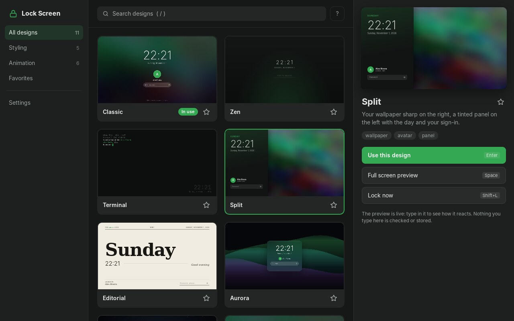

- **Ten designs**, from minimal to animated. Some react as you type, and a wrong password makes some of them shake, scatter or glitch.
- **An explorer** with live thumbnails, search, favorites, a full screen preview and settings
- **Follows your theme**: the accent colour comes from your Cinnamon/GTK theme, and the wallpaper, name and picture (`~/.face`) are yours
- **Works everywhere Cinnamon locks**: Super+L, the menu's *Lock Screen*, idle locking and locking before suspend
- **Your normal sign-in**: authenticates through the same PAM service as Cinnamon's own lock screen, so a fingerprint reader set up with `fprintd` works too
- **Multi-monitor**: the design on the primary screen, a clock on the others
- **Hard to break**: a supervisor process keeps the screen covered and grabbed if the lock screen UI ever crashes (see [How it stays locked](#how-it-stays-locked))
- **Write your own**: a design is a single HTML file

## Designs

<table>
<tr>
<td align="center">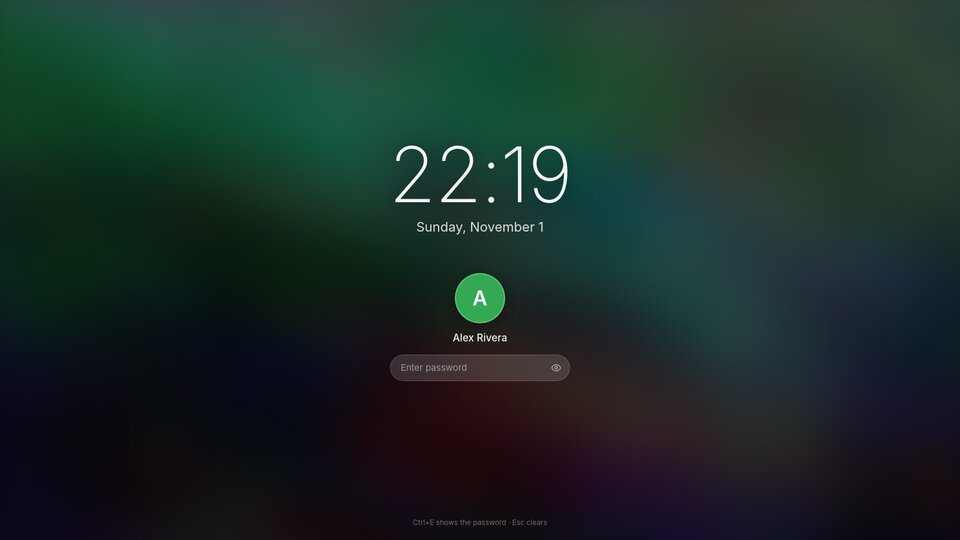<br><b>Classic</b><br><sub>Big clock over your blurred wallpaper</sub></td>
<td align="center"><br><b>Zen</b><br><sub>Thin clock, one line to type on</sub></td>
<td align="center">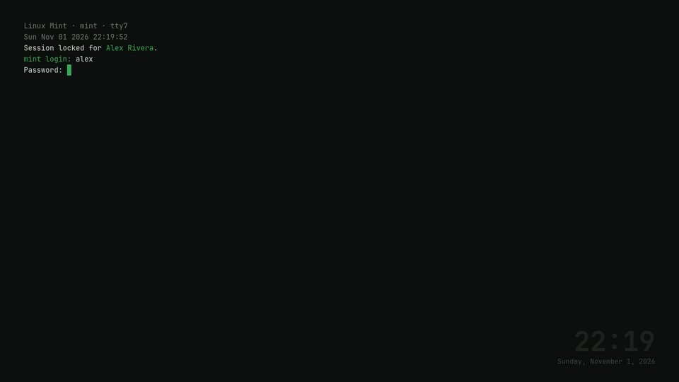<br><b>Terminal</b><br><sub>A text console login prompt</sub></td>
</tr>
<tr>
<td align="center">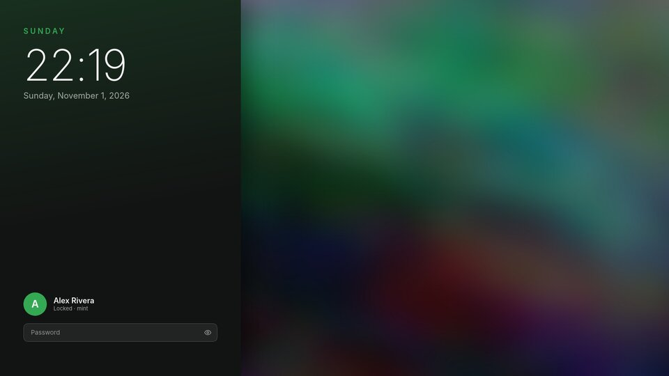<br><b>Split</b><br><sub>Sharp wallpaper, tinted sign-in panel</sub></td>
<td align="center">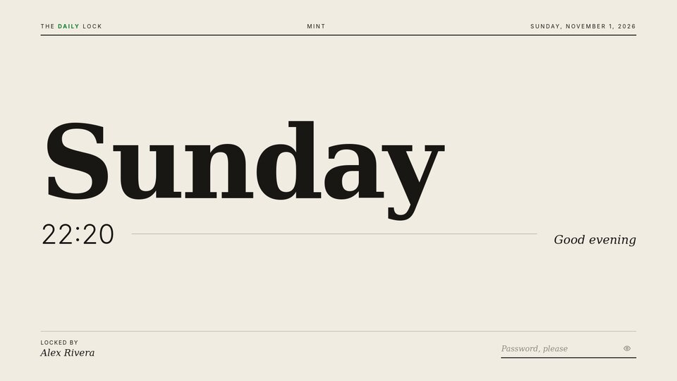<br><b>Editorial</b><br><sub>Magazine-cover typography</sub></td>
<td align="center">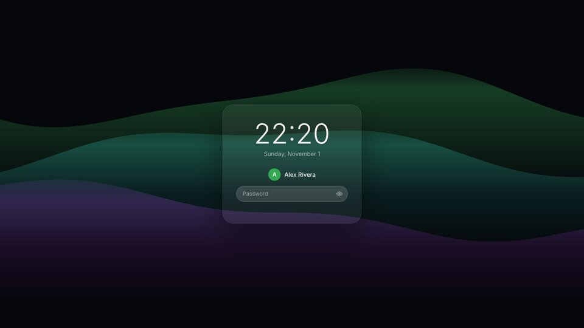<br><b>Aurora</b><br><sub>Drifting light behind frosted glass</sub></td>
</tr>
<tr>
<td align="center">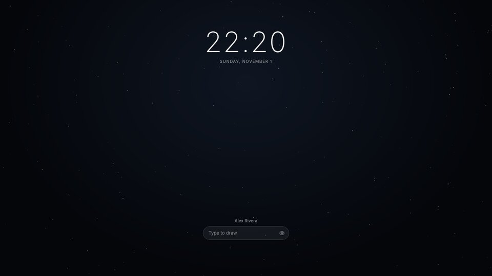<br><b>Constellation</b><br><sub>Each key lights a star and joins it to the last</sub></td>
<td align="center">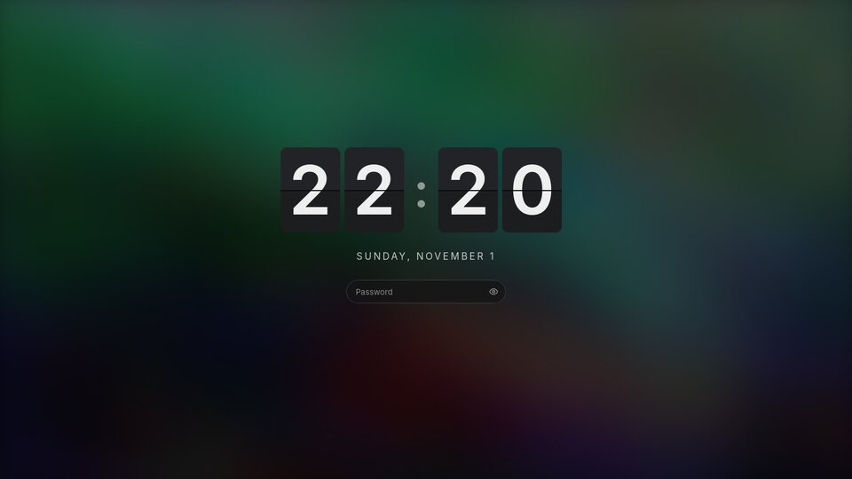<br><b>Flip</b><br><sub>Split-flap clock</sub></td>
<td align="center">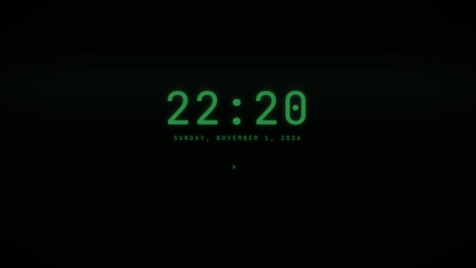<br><b>Phosphor</b><br><sub>Old CRT with scanlines and glow</sub></td>
</tr>
<tr>
<td align="center">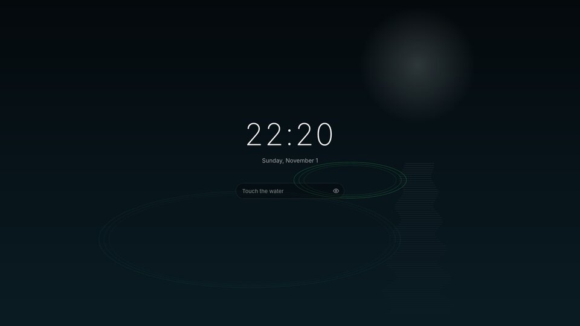<br><b>Pond</b><br><sub>Every key drops a ripple</sub></td>
<td align="center">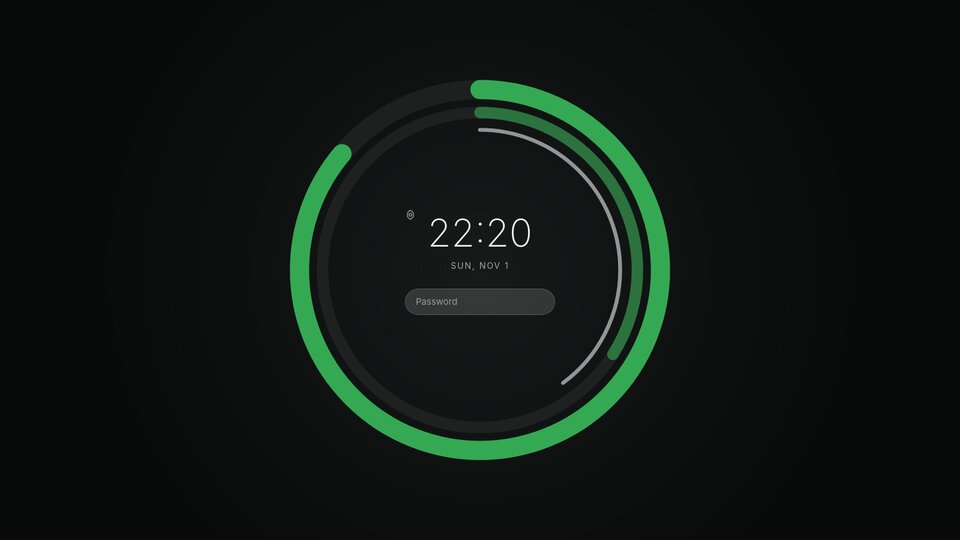<br><b>Orbit</b><br><sub>Time as three closing rings</sub></td>
<td></td>
</tr>
</table>

Constellation and Pond come alive as you type; the screenshots show them at rest.
The screenshots use a demo name and wallpaper. On your machine every design shows your own.

## Requirements

- Linux Mint with **Cinnamon on X11** (the default Cinnamon session). Tested on Mint 22.3.
- `python3-gi`, `gir1.2-gtk-3.0`, `gir1.2-webkit2-4.1`, `python3-pam` and `python3-xlib`. Most come with Mint, and `install.sh` installs any that are missing.

## Install

```sh
git clone https://github.com/PhillipMwaniki/mint-lock.git
cd mint-lock
./install.sh
```

The installer copies everything to `~/.local/share/mint-lock/app`, puts `mint-lock` in `~/.local/bin`
and adds **Lock Screen Explorer** to the menu. Root is only needed if a package is missing.

At the end it asks whether Cinnamon should start using mint-lock. You can say no and try it first:

```sh
mint-lock lock --test       # a design in a normal window; nothing is locked, close it any time
mint-lock explore           # pick a design
mint-lock enable            # now make Cinnamon lock with it
```

`./install.sh --enable` installs and switches Cinnamon over in one go.

> **Before you rely on it:** lock once with Super+L while you're at the machine and check that your password unlocks it.

## Usage

```sh
mint-lock explore            # the explorer
mint-lock lock               # lock now (Super+L does the same once enabled)
mint-lock list               # list designs; * marks the one in use
mint-lock set aurora         # choose a design
mint-lock preview flip       # full screen preview, nothing locked (Esc closes, Ctrl+U plays the unlock)
mint-lock config             # show settings
mint-lock config clock24 false
mint-lock status             # is Cinnamon using mint-lock, is the screen locked
mint-lock enable | disable   # switch Cinnamon over / back
```

**In the explorer:** use the arrow keys (or H J K L) to browse. Enter uses the selected design and Space opens it full screen.
F stars it, `/` searches and Tab moves through the sections. Shift+L locks the screen and `?` lists every key.
The big preview on the right is live, so click it and type to see how the design reacts. Nothing typed there is checked.

**On the lock screen:** type your password and press Enter. Ctrl+E shows what you typed and Esc clears it.
If a fingerprint reader is enrolled, touching it works as well. After 45 seconds without input the design dims.
On battery at 15% or less, a warning shows in the top-right corner.

### Settings

In the explorer under **Settings**, or with `mint-lock config <key> <value>`:

| Key | Default | |
| --- | --- | --- |
| `design` | `classic` | Design in use |
| `clock24` | `true` | 24-hour clock |
| `showSeconds` | `false` | Seconds in text clocks |
| `accent` | *(theme)* | Accent colour such as `#e54980`; empty follows the Cinnamon theme |
| `blur` | `18` | Wallpaper blur in px |
| `dim` | `0.35` | Wallpaper darkening, 0–0.9 |
| `showUser` | `true` | Show your name and picture |
| `message` | *(empty)* | A line on designs that have one, such as "Back in 10" |
| `reduceMotion` | `false` | Keep animation to a minimum |

Settings live in `~/.config/mint-lock/config.json`.

## How it stays locked

Cinnamon has a setting, `org.cinnamon.desktop.screensaver custom-screensaver-command`, for using a different locker.
`mint-lock enable` points it at `mint-lock lock`. From then on, Super+L, the menu and Cinnamon's power daemon (on idle and before suspend) run mint-lock instead of
cinnamon-screensaver.

`mint-lock lock` starts a small **supervisor**. It uses only python-xlib, with no GTK and no web engine:

1. It covers every monitor with a black window and grabs the keyboard and mouse.
2. It starts Cinnamon's own `cs-backup-locker` to watch that window, so even if the supervisor is killed the screen stays locked.
3. It starts the lock screen UI (GTK + WebKit) and hands the grab over once the UI is on screen.
4. If the UI crashes or is killed, the supervisor takes the grab back at once and restarts the UI. After three crashes in a minute it falls back to a plain GTK password box with no web engine.
5. It unlocks only when PAM accepts the password (or fingerprint), checked through the `cinnamon-screensaver` PAM service in a separate helper process.

Before suspend, the system waits until the lock screen is up (`XSS_SLEEP_LOCK_FD`), so the desktop never shows when the machine wakes up.
SIGTERM and Ctrl+C don't unlock anything.

The X11 limits are the same as for any X11 locker, cinnamon-screensaver included. A program that is already holding a grab when you lock can delay the lock grabbing the keyboard. Ctrl+Alt+F*n* still switches to a text console.

### If you're ever stuck behind it

From a text console (Ctrl+Alt+F2), log in and run:

```sh
pkill -USR1 -f "mint-lock lock"     # ends the lock
mint-lock disable                   # optional: back to Cinnamon's lock screen
```

Then return to the desktop with Ctrl+Alt+F7 (or F1, depending on your setup).

## Writing your own design

Copy any file from `web/designs/` into `~/.local/share/mint-lock/designs/`, rename it and edit it.
It appears in the explorer next to the built-in designs, marked *Yours*. The **Open folder** button in Settings takes you there.

A design is one HTML file:

```html
<!doctype html>
<html>
<head>
<meta charset="utf-8">
<script type="application/json" id="meta">
{ "name": "Mine", "description": "What it looks like", "tags": ["minimal"], "category": "Styling" }
</script>
<link rel="stylesheet" href="../lib/lock.css">
<script src="../lib/lock.js"></script>
</head>
<body>
  <div class="ml-wallpaper"></div>
  <div data-ml-time></div>
  <div data-ml-date="long"></div>
  <label class="ml-field" data-ml-field>
    <input data-ml-password><button class="ml-reveal" data-ml-reveal></button>
  </label>
  <div class="ml-status" data-ml-status></div>
</body>
</html>
```

`../lib` works in your designs folder too: the installer links it to the installed runtime.

The runtime fills in anything marked with these attributes: `data-ml-time`, `data-ml-date` (`long`, `short`, `full`, `weekday`),
`data-ml-name`, `data-ml-user`, `data-ml-host`, `data-ml-avatar`, `data-ml-greeting` and `data-ml-message`.
It wires up the `data-ml-password` input, the `data-ml-status` line and the shake on a wrong password.
CSS variables: `--accent`, `--accent-rgb`, `--on-accent`, `--wallpaper`, `--blur`, `--dim`, `--font`, `--mono` and `--serif`.

For anything more, use `MintLock` in JavaScript:

```js
MintLock.on("key", (k) => { /* k.kind: char | backspace | clear | submit; k.length */ });
MintLock.on("auth", (state, text) => { /* ready | busy | info | failed */ });
MintLock.on("tick", (date) => {});          // every second
MintLock.on("unlock", (done) => {});        // play an outro; call done() to finish early
MintLock.canvas("#c", (ctx, w, h, dt, t) => {});   // animation loop that pauses while dimmed
MintLock.env;                               // user, realName, accent, wallpaper, clock24, battery, ...
```

To test without locking, run `mint-lock lock --test --design mine`, or `mint-lock lock --test --debug` to get the web inspector.

## Uninstall

```sh
./uninstall.sh            # puts Cinnamon's lock screen back and removes mint-lock
./uninstall.sh --purge    # also removes your settings and your own designs
```

## Project layout

```
bin/mint-lock           command line
mintlock/supervisor.py  the shield, grab and crash recovery (python-xlib only)
mintlock/locker.py      lock screen UI: one window per monitor, WebKit view, safe-mode fallback
mintlock/auth.py        drives PAM through mintlock/authhelper.py processes
mintlock/explorer.py    the explorer window and full screen preview
web/lib/                lock.js + lock.css, the runtime every design uses
web/designs/            the designs
web/explorer/           the explorer UI
```

## License

[MIT](LICENSE)
